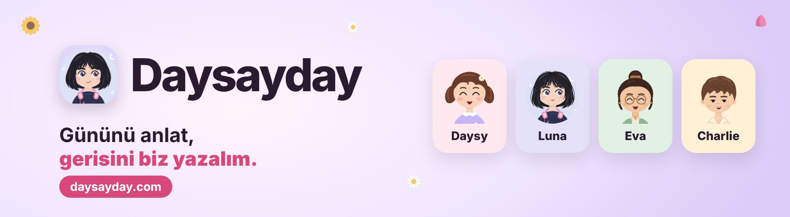
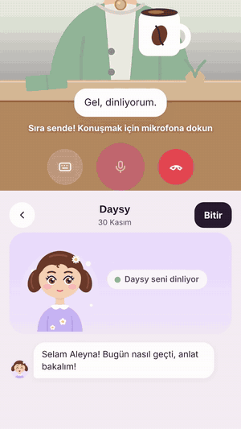
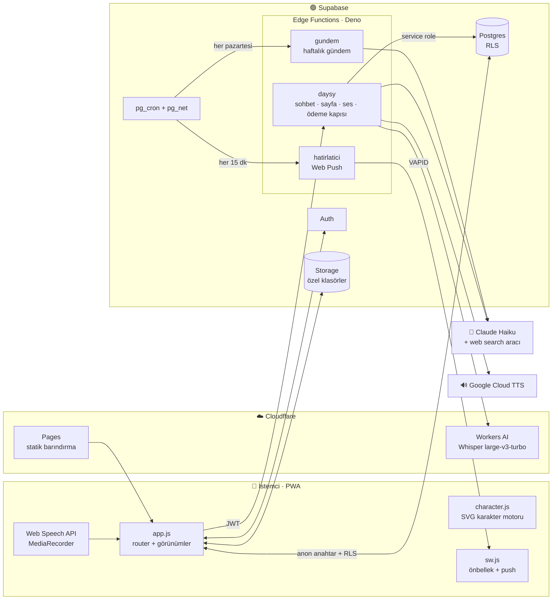
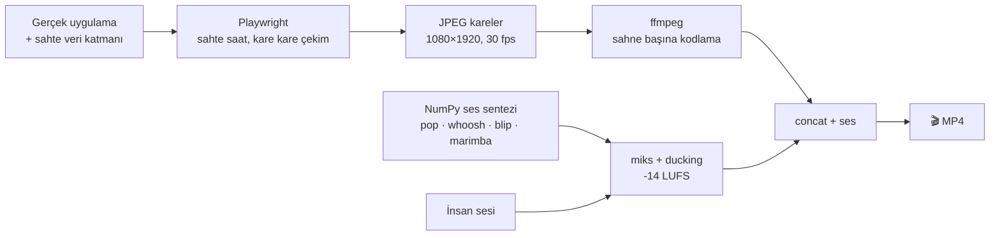

<div align="center">



<br>

**Konuşarak tutulan, yapay zekâ destekli Türkçe günlük uygulaması.**
Gününü bir karaktere yazarak, sesli ya da görüntülü anlatırsın; sohbet senin ağzından yazılmış, tarihli bir günlük sayfasına dönüşür.

<br>

[](https://daysayday.com)


</div>

---

## 🎬 Uygulamadan görüntüler

<div align="center">

<sub>Dört karakter, dört kişilik: Daysy, Luna, Eva ve Charlie. Hepsi koddan çizilen SVG, hepsi gerçek zamanlı konuşuyor.</sub>
</div>

<br>

<table>
<tr>
<td align="center" width="33%"><br><b>Görüntülü konuş</b><br><sub>Konuşma tanıma, sesli yanıt, dudak senkronu ve ifade değişimi</sub></td>
<td align="center" width="33%"><br><b>Sohbet → günlük sayfası</b><br><sub>Konuşma bittiğinde, senin ağzından yazılmış tarihli bir sayfa</sub></td>
<td align="center" width="33%"><br><b>Mağazasız kurulum</b><br><sub>Siteden ana ekrana eklenen PWA</sub></td>
</tr>
</table>

> Bu GIF'lerin hiçbiri ekran kaydı değil. Tanıtım videoları, gerçek uygulamanın **sahte bir saatle** Playwright'ta kare kare çekilmesiyle üretildi. Ayrıntısı [aşağıda](#-kodla-üretilen-tanıtım-videoları).

---

## ✨ Özellikler

| | |
|---|---|
| 💬 **Üç yoldan anlat** | Yazarak mesajlaş, sesli konuş ya da görüntülü ara. Üçü de aynı sohbete akar. |
| 📖 **Otomatik günlük** | Sohbet, kullanıcının ağzından, birinci tekil şahısla yazılmış bir sayfaya dönüşür: başlık, metin ve günün duygusu. |
| 🎭 **Dört karakter** | Daysy neşeli ve meraklı; Luna esprili ve dürüst; Eva sakin ve tecrübeli bir abla; Charlie şakacı bir sinefil. Her birinin kendine ait sesi, sahnesi ve konuşma tarzı var. |
| 🌼 **Duygu çiçekleri ve seri** | Her günün bir çiçeği var; vazo dolar, seri alevi büyür, 3 / 7 / 14 / 30 / 50 / 100 / 365 gün kilometre taşları. |
| 🔒 **Kilitli günler** | 4 haneli PIN, tarayıcıda PBKDF2 ile özetlenir. Sunucuya PIN değil, özet gider. |
| 🖼️ **Fotoğraf çıkartmaları** | Sayfaya sürükle-bırak fotoğraf; kullanıcıya özel, herkese kapalı depolama. |
| ✉️ **Geleceğe mektup** | Belirlenen tarihte açılan zaman kapsülü. |
| 🔔 **Akşam hatırlatması** | Kullanıcının saat diliminde akşam bildirimi; seri tehlikedeyse gece ikinci bir hatırlatma. Web Push ile. |
| 🎞️ **Gündem bilen Charlie** | Haftalık bir görev, Türkiye'nin dizi ve film gündemini webde arayıp Charlie'nin hafızasına ekler. |
| 💳 **Ödeme altyapısı** | Ücretsiz kotalar, sayfa paketleri ve abonelik; sunucuda doğrulanan, idempotent hak sistemi. Bayrakla kapalı, sağlayıcıya bağlanmayı bekliyor. |

---

## 🏗️ Mimari



**Temel ilke:** İstemci yalnızca yayınlanabilir anon anahtarı bilir ve veritabanına satır düzeyi güvenlik (RLS) arkasından erişir. Model çağrıları, ses servisleri, ödeme hakları ve bildirim gönderimi sadece Edge Function'larda, sunucu tarafındaki gizli anahtarlarla yapılır.

---

## 🧰 Teknoloji yığını

| Katman | Kullanılan |
|---|---|
| **Ön yüz** | Framework'süz Vanilla JS (ES modülleri), elle yazılmış CSS, hash tabanlı router |
| **Karakterler** | Koddan üretilen SVG; 8 ifade, göz kırpma, bakış, dudak senkronu (viseme) |
| **PWA** | Service Worker, Web App Manifest, Web Push (VAPID), standalone yönlendirme |
| **Arka uç** | Supabase: Postgres, Auth, Storage, Edge Functions (Deno), pg_cron, pg_net |
| **Yapay zekâ** | Claude Haiku (sohbet, sayfa yazımı, web search aracıyla gündem) |
| **Ses** | Web Speech API → iOS'ta MediaRecorder + Whisper large-v3-turbo (Cloudflare Workers AI); Google Cloud TTS, yedek olarak tarayıcı `speechSynthesis` |
| **Barındırma** | Cloudflare Pages, `_headers` ile önbellek denetimi |
| **Test ve video** | Playwright, yerel Postgres 16, Node test düzeneği, ffmpeg, NumPy ile ses sentezi |

---

## 🔬 Öne çıkan mühendislik kararları

<details open>
<summary><b>1. Atomik ve idempotent ödeme kapısı</b></summary>

<br>

Bir günlük sayfası yazdırmak model çağrısı, yani gerçek maliyet demek. Bu yüzden hak kontrolü istemciye bırakılmadı:

- **Kapı modelden önce:** `billing_page_decision()` sırasıyla `done / free / sub / credit / blocked` döner; hak yoksa model hiç çağrılmaz. Charlie kilitliyse sohbet isteği de modele gitmeden `402` ile kapanır.
- **Hak, kayıtla aynı işlemde düşer:** `billing_commit_page()` satırı kilitler (`FOR UPDATE`); sayfayı yazar, defter kaydını ekler ve krediyi tek işlemde düşürür. Model hata verirse hak düşmez.
- **İdempotens:** İstemci `request_id = SHA-256(gün, anahtar, tüm mesajlar)` gönderir. Aynı istek iki kez gelirse (ağ kopması, çift dokunma) model yeniden çağrılmaz, kayıtlı sayfa döner, hak ikinci kez düşmez. `page_ledger (user_id, request_id)` benzersiz kısıtıyla garanti altında.
- **Kota günü:** İstanbul saatine göre hesaplanır. Dünkü bir sayfa bugünün değil dünün kotasından düşer.
- **İstemci "ödedim" diyemez:** Haklar yalnızca sunucuda doğrulanmış satın alma kaydından yazılır. Fiyatlar kuruş cinsinden yalnızca Edge Function'da durur. `payments_enabled` bayrağı varsayılan olarak kapalıdır. Tablolarda kullanıcı yalnızca kendi satırını okur, yazma yetkisi yoktur.

Bu katman yerel Postgres 16 üzerinde **52 SQL testi** ve gerçek Edge Function kodunu sahte bir model ve veritabanıyla çalıştıran **28 uçtan uca test** ile doğrulandı. Bkz. [`tests/`](tests/).

</details>

<details>
<summary><b>2. Sesli ve görüntülü konuşma: her tarayıcıda çalışan zincir</b></summary>

<br>

- Chrome ve Android'de **Web Speech API** ile canlı dikte.
- iOS'ta ve Web Speech API olmayan tarayıcılarda **MediaRecorder** ile kayıt (codec sırası: opus/webm → mp4 → webm → ogg). Kayıt, Edge Function üzerinden **Whisper large-v3-turbo**'ya gider.
- Yanıt **Google Cloud TTS** ile seslendirilir; anahtar yoksa ya da istek başarısız olursa tarayıcının Türkçe sesine düşülür.
- Model çıktısı konuşulacak metne indirgenir: etiket, isim, JSON ve tırnak temizlenir, kelime ortasında kesilmez.
- Karakterin ağzı, konuşulan harfe göre seçilen **viseme** şekilleriyle oynar.

</details>

<details>
<summary><b>3. Bağımlılıksız SVG karakter motoru</b></summary>

<br>

`character.js` (~780 satır) dört karakteri tek bir parametrik yüz fonksiyonundan çizer: göz biçimi (yuvarlak / badem), iris, kirpik, kaş eğrisi, göz kapağı, dudak rengi. Her karakterin 8 ifadesi var: *neutral, happy, sad, surprised, thinking, smirk, unimpressed, cheeky*. Göz kırpma, boşta hareketler ve ifade geçişleri CSS dönüşümleriyle yapılır. Görsel dosya yok, her şey vektör.

</details>

<details>
<summary><b>4. Gizlilik ve güvenlik</b></summary>

<br>

- **RLS her tabloda:** Kullanıcı yalnızca kendi profilini, sayfalarını, mektuplarını ve fotoğraflarını görür.
- **Depolama:** `photos` kovası herkese kapalı, dosya başına 5 MB sınırlı. Politikalar `storage.foldername(name)[1] = auth.uid()` ile kişiye özel klasöre kilitli.
- **PIN:** Tarayıcıda `PBKDF2-SHA256`, 150.000 tur, kullanıcıya özel tuz. Sunucuda PIN değil, özet saklanır.
- **Hesap silme:** Edge Function kullanıcının bütün depolama klasörlerini dolaşıp siler, sonra hesabı kaldırır.
- **KVKK onayı sürümlü:** Metin değişince kullanıcıdan yeniden onay istenir.
- **Gizli anahtarlar** yalnızca Supabase Edge Function Secrets'ta durur. Zamanlanmış görevler `x-cron-secret` başlığıyla korunur. Geliştirme hakları (`DEV_GRANTS`) üretimde tanımsızdır.

</details>

<details>
<summary><b>5. Saat dilimine duyarlı push bildirimleri</b></summary>

<br>

`pg_cron`, her 15 dakikada `pg_net` ile `hatirlatici` fonksiyonunu çağırır. Fonksiyon, yerel saati hatırlatma saatine gelmiş, o gün yazmamış ve o gün bildirim almamış kullanıcıları seçer. Mesajı seriye göre değişen bir havuzdan seçer ve `web-push` + VAPID ile gönderir. Uzun süredir yazmayan kullanıcıya bildirim seyrekleşir: 3–6 gün arası gün aşırı, 7 günden sonra haftada bir, 60 günden sonra hiç. Süresi dolan abonelikler (`404/410`) otomatik temizlenir.

</details>

<details>
<summary><b>6. PWA güncelleme stratejisi</b></summary>

<br>

- Sürümlü varlıklar (`app.js?v=YYMMDDHHMM`) ve sürüm adlı önbellek, eski önbelleği temizleyen Service Worker.
- `_headers` ile HTML, uygulama, SW, yapılandırma ve manifest için `no-cache`.
- Manifest `id: "/app/"`; yüklü uygulama açılışta tanıtım sayfasını atlayıp doğrudan uygulamaya yönlenir.
- Simge değişiminde dosya adları değiştirildi, böylece Android Chrome yüklü uygulamanın simgesini güncellemeyi önerir.

</details>

<details>
<summary><b>7. Gündemi bilen karakter</b></summary>

<br>

`gundem` fonksiyonu her pazartesi sabahı Claude'un **web search aracıyla** Türkiye'deki dizi, film ve sosyal medya gündemini arar. Siyaset, şiddet, magazin ve gerçek kişiler hakkındaki dedikodu bilinçli olarak dışarıda bırakılır. Sonuç 10–14 kısa madde olarak `trends` tablosuna yazılır. Bu tabloyu kullanıcılar okuyamaz; Charlie sohbet sırasında sunucu üzerinden bu maddelere bakar.

</details>

---

## 🎥 Kodla üretilen tanıtım videoları

TikTok ve YouTube için hazırlanan bütün tanıtım videoları **gerçek uygulamanın kendisinden** üretildi. Hazır video, stok görüntü ya da sahte arayüz kullanılmadı.



- **Sahte saat:** `requestAnimationFrame`, `setTimeout` ve `Date` kontrol altına alınır. Her kare deterministik ve hızdan bağımsızdır.
- **Senkron ses:** Karakterin konuştuğu her hece bir zaman damgası olarak JSON'a yazılır; ses miksi bu zamanlarla birebir hizalanır.
- **Platform güvenli alanı:** TikTok'un arama çubuğu, sağ buton sütunu ve alt açıklama alanı hesaba katılarak arayüz öğeleri kayıt anında yeniden konumlandırılır.

---

## 📁 Proje yapısı

```
.
├── index.html               # tanıtım sayfası (SEO, OG, kurulum rehberi)
├── telefona-kur.html        # iPhone / Android kurulum adımları
├── gizlilik.html            # KVKK aydınlatma metni
├── manifest.webmanifest
├── sw.js                    # önbellek + push + bildirim tıklama
├── _headers                 # Cloudflare önbellek kuralları
├── config.js                # Supabase URL + anon anahtar (yayınlanabilir)
├── llms.txt                 # yapay zekâ arama motorları için özet
├── app/
│   ├── index.html
│   ├── app.js               # router, görünümler, sohbet, arama, ödeme kapısı (~2.1k satır)
│   ├── character.js         # SVG karakter + ses motoru (~780 satır)
│   └── app.css
├── img/                     # simgeler, avatarlar, duygu çiçekleri
└── kurulum/                 # sırayla çalıştırılan SQL ve Edge Function dosyaları
    ├── 1-veritabani.sql
    ├── 2-edge-function-daysy.ts
    ├── 3-kilit-ve-fotograf.sql
    ├── 4-charlie.sql
    ├── 5-charlie-dizi-gundem.sql
    ├── 6-edge-function-gundem.ts
    ├── 7-haftalik-gundem-cron.sql
    ├── 8-bildirimler.sql
    ├── 9-edge-function-hatirlatici.ts
    └── 10-odeme.sql
├── tests/                   # ödeme katmanı: 52 SQL + 28 uçtan uca test
└── docs/                    # README görselleri
```

---

## 🚀 Kendi ortamında çalıştırma

<details>
<summary><b>Adım adım kurulum</b></summary>

<br>

1. **Supabase projesi aç.** `kurulum/` içindeki `.sql` dosyalarını numara sırasıyla SQL Editor'de çalıştır. Hepsi tekrar çalıştırılabilir yazıldı.
2. **Edge Function'ları oluştur:** `daysy`, `gundem`, `hatirlatici`. `gundem` ve `hatirlatici` cron ile çağrıldığı için *Verify JWT* kapalı olmalı.
3. **Secrets ekle** (Supabase → Edge Functions → Secrets). Değerleri asla koda yazma:

   | Ad | Ne için |
   |---|---|
   | `ANTHROPIC_API_KEY` | sohbet, sayfa, gündem |
   | `CF_ACCOUNT_ID`, `CF_AI_TOKEN` | Whisper (konuşmadan metne) |
   | `GOOGLE_TTS_API_KEY` | seslendirme (isteğe bağlı) |
   | `VAPID_PUBLIC_KEY`, `VAPID_PRIVATE_KEY`, `VAPID_SUBJECT` | Web Push |
   | `CRON_SECRET` | zamanlanmış görevlerin doğrulanması |

   `VAPID` anahtarları `hatirlatici?kurulum=1` adresinden üretilebilir. `DEV_GRANTS`'ı üretimde **tanımlama**.
4. **`config.js`** dosyasına Supabase URL'ini ve **yalnızca** anon anahtarını yaz.
5. Klasörü **Cloudflare Pages**'e yükle (Git ya da Direct Upload).

</details>

---

## 🧭 Bu projede gösterilen yetkinlikler

- **Ürün:** Fikirden canlı ürüne tek başına; isimlendirme, karakter tasarımı, metin yazımı, fiyatlandırma kurgusu, KVKK.
- **Full-stack:** Framework'süz ön yüz, Postgres şema tasarımı, RLS, PL/pgSQL, sunucusuz fonksiyonlar, zamanlanmış görevler.
- **Yapay zekâ entegrasyonu:** Karakter başına sistem istemleri, araç kullanımı (web search), maliyet ve kota kontrolü, çıktı temizleme, konuşma ve ses zinciri.
- **Güvenlik ve güvenilirlik:** Sunucu tarafı yetkilendirme, idempotent ödeme akışı, satır kilitleme, istemci tarafı kriptografi.
- **Büyüme:** Kodla üretilen video içerik hattı, SEO ve `llms.txt`, platform güvenli alanına göre kurgu, push bildirimleriyle elde tutma.

---

## 🗺️ Yol haritası

- [x] Sohbet, sesli ve görüntülü konuşma
- [x] Otomatik günlük sayfası, duygu çiçekleri, seri
- [x] PIN kilidi, fotoğraflar, geleceğe mektup
- [x] Web Push hatırlatmaları
- [x] Ödeme kapısı ve hak sistemi (bayrakla kapalı)
- [ ] Ödeme sağlayıcısı bağlantısı (`startCheckout(sku)` noktası hazır)
- [ ] İngilizce arayüz

---

<div align="center">


**[daysayday.com](https://daysayday.com)** · Gününü anlat, gerisini biz yazalım.

<sub>© 2026 Daysayday. Tüm hakları saklıdır. Karakterler ve görseller izinsiz kullanılamaz.</sub>

</div>
