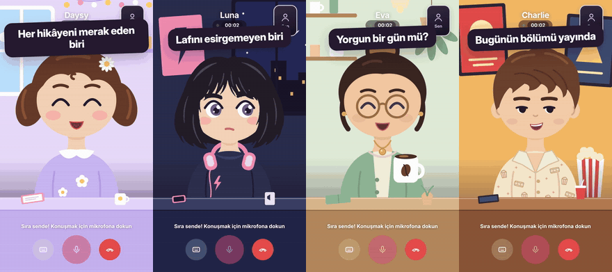
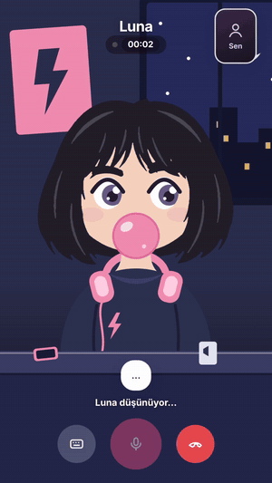
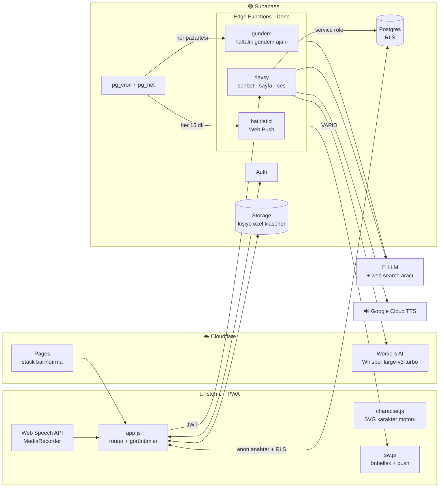
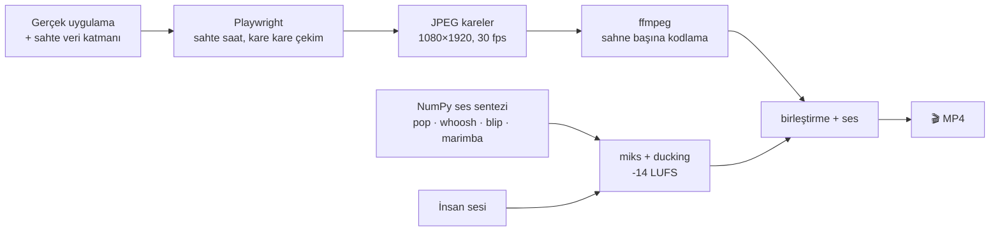

<div align="center">


<br>

**Konuşarak tutulan, yapay zekâ destekli Türkçe günlük uygulaması.**
Gününü bir karaktere yazarak, sesli ya da görüntülü anlatırsın; sohbet senin ağzından yazılmış, tarihli bir günlük sayfasına dönüşür.

<br>

[](https://daysayday.com)
[](https://www.tiktok.com/@daysayday)
[](https://www.youtube.com/@daysayday)


</div>

---

Daysayday'i **fikirden canlı ürüne kadar tek başıma** geliştirdim: ürün tasarımı, karakterler, ön yüz, veritabanı, sunucusuz arka uç, yapay zekâ ve ses entegrasyonu, yayın ve tanıtım içerikleri. Bu README, uygulamanın ne yaptığını ve bunu yaparken hangi mühendislik problemlerini nasıl çözdüğümü anlatıyor.

## 🎬 Uygulamadan görüntüler

<div align="center">

<sub>Dört karakter, dört kişilik: Daysy, Luna, Eva ve Charlie. Hepsi koddan çizilen SVG, hepsi gerçek zamanlı konuşuyor.</sub>
</div>

<br>

<table>
<tr>
<td align="center" width="33%"><br><b>Görüntülü konuş</b><br><sub>Konuşma tanıma, sesli yanıt, dudak senkronu, ifade değişimi</sub></td>
<td align="center" width="33%"><br><b>Sohbet → günlük sayfası</b><br><sub>Konuşma bitince senin ağzından yazılmış tarihli bir sayfa</sub></td>
<td align="center" width="33%"><br><b>Mağazasız kurulum</b><br><sub>Siteden ana ekrana eklenen PWA</sub></td>
</tr>
</table>

> Bu GIF'lerin hiçbiri ekran kaydı değil. Hepsi, gerçek uygulamanın **sahte bir saatle** kare kare çekilmesiyle koddan üretildi. Ayrıntısı [aşağıda](#-kodla-üretilen-tanıtım-videoları).

---

## 👩‍💻 Bu projede neler yaptım

| Alan | Somut olarak |
|---|---|
| **Ön yüz** | Framework kullanmadan ~2.100 satırlık ES modül uygulaması: hash tabanlı router, durum yönetimi, sürükle-bırak, ses kaydı, elle yazılmış CSS |
| **Grafik ve animasyon** | Tek parametrik fonksiyondan dört karakter çizen SVG motoru; 8 ifade, göz kırpma, bakış, boşta hareketler, harfe göre dudak senkronu |
| **Veritabanı** | PostgreSQL şema tasarımı, her tabloda satır düzeyi güvenlik (RLS), PL/pgSQL fonksiyonları, tekrar çalıştırılabilir (idempotent) migration dosyaları |
| **Sunucusuz arka uç** | Deno + TypeScript ile üç Edge Function: sohbet ve sayfa yazımı, push bildirimleri, haftalık gündem ajanı |
| **Yapay zekâ** | Karakter başına sistem istemleri, sohbetten yapılandırılmış JSON üretimi, web search aracıyla çalışan zamanlanmış ajan, model çıktısını temizleme, kullanım kaydı |
| **Ses** | Tarayıcıya göre seçilen konuşma tanıma zinciri (Web Speech API → MediaRecorder + Whisper), bulut seslendirme ve tarayıcı yedeği |
| **Güvenlik** | Gizli anahtarların yalnızca sunucuda tutulması, kişiye özel depolama politikaları, istemci tarafında PBKDF2 ile PIN özeti, sürümlü KVKK onayı, eksiksiz hesap silme |
| **PWA ve DevOps** | Service Worker, Web Push (VAPID), pg_cron ile zamanlanmış görevler, Cloudflare Pages, önbellek başlıkları, sürümlü varlıklar |
| **Otomasyon** | Playwright + ffmpeg + NumPy ile uygulamanın kendisinden tanıtım videosu üreten hat |
| **Ürün ve büyüme** | Karakter ve marka tasarımı, metin yazımı, SEO ve `llms.txt`, TikTok ve YouTube içerik üretimi |

---

## 🏗️ Mimari



**Temel ilke:** İstemci yalnızca yayınlanabilir anon anahtarı bilir ve veritabanına satır düzeyi güvenliğin (RLS) arkasından erişir. Model çağrıları, ses servisleri ve bildirim gönderimi sadece Edge Function'larda, sunucu tarafındaki gizli anahtarlarla yapılır.

---

## 🧰 Teknoloji yığını

| Katman | Kullanılan |
|---|---|
| **Ön yüz** | Vanilla JavaScript (ES modülleri), HTML, CSS |
| **Karakterler** | Koddan üretilen SVG, CSS dönüşümleri |
| **PWA** | Service Worker, Web App Manifest, Web Push (VAPID) |
| **Arka uç** | Supabase: PostgreSQL, Auth, Storage, Edge Functions (Deno + TypeScript), pg_cron, pg_net |
| **Yapay zekâ** | Claude Haiku (sohbet, sayfa yazımı, web search aracıyla gündem) |
| **Ses** | Web Speech API, MediaRecorder, Whisper large-v3-turbo (Cloudflare Workers AI), Google Cloud TTS, `speechSynthesis` |
| **Barındırma** | Cloudflare Pages |
| **Otomasyon** | Playwright, ffmpeg, Python, NumPy |

---

## 🔬 Teknik derinlik

<details open>
<summary><b>1. Her tarayıcıda çalışan ses zinciri</b></summary>

<br>

Sesli ve görüntülü konuşmanın iPhone, Android ve masaüstünde aynı şekilde çalışması gerekiyordu, ama tarayıcıların konuşma tanıma desteği çok farklı:

- Chrome ve Android'de **Web Speech API** ile canlı dikte.
- iOS'ta ve Web Speech API olmayan tarayıcılarda **MediaRecorder** ile kayıt. Codec, cihazın desteğine göre sırayla seçilir: opus/webm → mp4 → webm → ogg. Kayıt Edge Function üzerinden **Whisper large-v3-turbo**'ya gider.
- Yanıt **Google Cloud TTS** ile seslendirilir. Anahtar yoksa ya da istek başarısız olursa tarayıcının Türkçe sesine geçilir; kullanıcı hiçbir durumda sessiz kalmaz.
- Model çıktısı konuşulacak metne indirgenir: etiket, isim, JSON ve tırnak temizlenir, cümle kelime ortasında kesilmez.
- Karakterin ağzı, o an söylenen harfe göre seçilen **viseme** şekilleriyle oynar.

</details>

<details>
<summary><b>2. Bağımlılıksız SVG karakter motoru</b></summary>

<br>

`character.js` (~780 satır) dört karakteri tek bir parametrik yüz fonksiyonundan çizer. Göz biçimi (yuvarlak / badem), iris, kirpik, kaş eğrisi, göz kapağı ve dudak rengi parametre olarak verilir. Her karakterin 8 ifadesi var: *neutral, happy, sad, surprised, thinking, smirk, unimpressed, cheeky*. Göz kırpma, bakış, boşta hareketler ve ifade geçişleri CSS dönüşümleriyle yapılır. Görsel dosyası yok, her şey vektör; bu yüzden her ekran boyutunda keskin ve uygulama çok hafif.

</details>

<details>
<summary><b>3. Sohbetten günlük sayfasına</b></summary>

<br>

Sohbet bittiğinde konuşmanın tamamı modele gider. Model, kullanıcının ağzından, birinci tekil şahısla yazılmış bir sayfayı **yapılandırılmış JSON** olarak döner: başlık, metin, günün anı, duygu, etiketler ve karakterin sayfanın altına düştüğü not. Çıktı doğrulanır ve temizlenir, sonra sayfa olarak kaydedilir. Uzun sohbetlerde bağlam penceresi bilinçli olarak kırpılır, art arda gelen aynı taraf mesajları birleştirilir. Her çağrının kullanım bilgisi `ai_usage` tablosuna yazılır; maliyet buradan takip edilir.

</details>

<details>
<summary><b>4. Gizlilik ve güvenlik</b></summary>

<br>

- **RLS her tabloda:** Kullanıcı yalnızca kendi profilini, sayfalarını, mektuplarını ve fotoğraflarını görür.
- **Depolama:** `photos` kovası herkese kapalı ve dosya başına 5 MB ile sınırlı. Politikalar `storage.foldername(name)[1] = auth.uid()` ile kişiye özel klasöre kilitli.
- **PIN:** Tarayıcıda `PBKDF2-SHA256` ile 150.000 tur ve kullanıcıya özel tuzla özetlenir. Sunucuda PIN değil, özet saklanır.
- **Hesap silme:** Edge Function, kullanıcının depolamadaki bütün klasörlerini dolaşıp siler, ardından hesabı kaldırır.
- **KVKK:** Onay metni sürümlüdür; metin değişince kullanıcıdan yeniden onay istenir.
- **Gizli anahtarlar** yalnızca Supabase Edge Function Secrets'ta durur. Zamanlanmış görevler `x-cron-secret` başlığıyla korunur.

</details>

<details>
<summary><b>5. Saat dilimine duyarlı push bildirimleri</b></summary>

<br>

`pg_cron`, her 15 dakikada `pg_net` ile `hatirlatici` fonksiyonunu çağırır. Fonksiyon şu kullanıcıları seçer: yerel saati hatırlatma saatine gelmiş, o gün yazmamış ve o gün henüz bildirim almamış olanlar. Mesaj, kullanıcının serisine göre değişen bir havuzdan seçilir ve `web-push` + VAPID ile gönderilir. Uzun süredir yazmayan kullanıcıya bildirimler seyrekleşir: 3–6 gün arası gün aşırı, 7 günden sonra haftada bir, 60 günden sonra hiç. Süresi dolmuş abonelikler (`404/410`) otomatik temizlenir.

</details>

<details>
<summary><b>6. Gündemi takip eden yapay zekâ ajanı</b></summary>

<br>

`gundem` fonksiyonu her pazartesi sabahı modelin **web search aracını** kullanarak Türkiye'deki dizi, film ve sosyal medya gündemini arar. Siyaset, şiddet, magazin ve gerçek kişiler hakkındaki dedikodu istemde açıkça dışarıda bırakılır. Sonuç 10–14 kısa madde olarak `trends` tablosuna yazılır. Bu tabloyu kullanıcılar okuyamaz; Charlie sohbet sırasında bu maddeleri sunucu üzerinden bilir ve "şu sıralar herkes onu konuşuyor" diyebilir.

</details>

<details>
<summary><b>7. PWA güncelleme stratejisi</b></summary>

<br>

- Sürümlü varlıklar (`app.js?v=YYMMDDHHMM`), sürüm adlı önbellek ve eski önbelleği temizleyen Service Worker.
- `_headers` ile HTML, uygulama, SW, yapılandırma ve manifest için `no-cache`.
- Manifest `id: "/app/"`; yüklü uygulama açılışta tanıtım sayfasını atlayıp doğrudan uygulamaya geçer.
- Simge değiştiğinde dosya adları da değiştirilir; böylece Android Chrome, yüklü uygulamanın simgesini güncellemeyi önerir.

</details>

---

## 🎥 Kodla üretilen tanıtım videoları

TikTok ve YouTube'daki bütün tanıtım videoları **gerçek uygulamanın kendisinden** üretildi. Hazır video, stok görüntü ya da sahte arayüz kullanılmadı.



- **Sahte saat:** `requestAnimationFrame`, `setTimeout` ve `Date` kontrol altına alınır. Her kare deterministik olur, çekimin hızı sonucu etkilemez.
- **Senkron ses:** Karakterin konuştuğu her hece zaman damgasıyla JSON'a yazılır; ses efektleri bu zamanlarla birebir hizalanır.
- **Platform güvenli alanı:** TikTok'un arama çubuğu, sağdaki buton sütunu ve alttaki açıklama alanı hesaba katılır; arayüz öğeleri kayıt anında bu alanların dışına yerleştirilir.

---

## 📣 Sosyal medya

Uygulamayı tanıtan içerikleri de kendim üretiyorum. Karakter tanıtımları, özellik videoları ve kurulum rehberleri yukarıdaki hatla koddan çıkıyor.

<div align="center">

[](https://www.tiktok.com/@daysayday)
[](https://www.youtube.com/@daysayday)
[](https://daysayday.com)

</div>

- İlk tanıtım videosu ilk gününde **6.000'den fazla izlenmeye** ulaştı.
- Her karakter için ayrı bir tanıtım serisi; mesajlaşma, sesli konuşma ve görüntülü konuşma her videoda gösteriliyor.
- iPhone ve Android için kurulum rehberi videoları.

---

## 📁 Proje yapısı

```
.
├── index.html               # tanıtım sayfası (SEO, Open Graph, kurulum rehberi)
├── telefona-kur.html        # iPhone / Android kurulum adımları
├── gizlilik.html            # KVKK aydınlatma metni
├── manifest.webmanifest
├── sw.js                    # önbellek + push + bildirim tıklama
├── _headers                 # Cloudflare önbellek kuralları
├── config.js                # Supabase URL + anon anahtar (yayınlanabilir)
├── llms.txt                 # yapay zekâ arama motorları için özet
├── app/
│   ├── index.html
│   ├── app.js               # router, görünümler, sohbet, arama (~2.1k satır)
│   ├── character.js         # SVG karakter + ses motoru (~780 satır)
│   └── app.css
├── img/                     # simgeler, avatarlar, duygu çiçekleri
├── kurulum/                 # numara sırasıyla çalıştırılan SQL ve Edge Function dosyaları
└── docs/                    # README görselleri
```

---

## 🚀 Kendi ortamında çalıştırma

<details>
<summary><b>Adım adım kurulum</b></summary>

<br>

1. **Bir Supabase projesi aç.** `kurulum/` içindeki `.sql` dosyalarını numara sırasıyla SQL Editor'de çalıştır. Hepsi tekrar çalıştırılabilir yazıldı.
2. **Edge Function'ları oluştur:** `daysy`, `gundem`, `hatirlatici`. `gundem` ve `hatirlatici` zamanlanmış görevlerle çağrıldığı için *Verify JWT* kapalı olmalı.
3. **Secrets ekle** (Supabase → Edge Functions → Secrets). Değerleri asla koda yazma:

   | Ad | Ne için |
   |---|---|
   | `ANTHROPIC_API_KEY` | sohbet, sayfa, gündem |
   | `CF_ACCOUNT_ID`, `CF_AI_TOKEN` | Whisper (konuşmadan metne) |
   | `GOOGLE_TTS_API_KEY` | seslendirme (isteğe bağlı) |
   | `VAPID_PUBLIC_KEY`, `VAPID_PRIVATE_KEY`, `VAPID_SUBJECT` | Web Push |
   | `CRON_SECRET` | zamanlanmış görevlerin doğrulanması |

   VAPID anahtarları `hatirlatici?kurulum=1` adresinden üretilebilir.
4. **`config.js`** dosyasına Supabase URL'ini ve **yalnızca** anon anahtarını yaz.
5. Klasörü **Cloudflare Pages**'e yükle (Git ya da Direct Upload).

</details>

---

## 🗺️ Yol haritası

- [x] Mesajlaşma, sesli ve görüntülü konuşma
- [x] Otomatik günlük sayfası, duygu çiçekleri, seri
- [x] PIN kilidi, fotoğraflar, geleceğe mektup
- [x] Web Push hatırlatmaları
- [x] Gündemi takip eden karakter
- [ ] İngilizce arayüz

---

<div align="center">


**[daysayday.com](https://daysayday.com)** · Gününü anlat, gerisini biz yazalım.

Geliştiren: [@aleynatombas](https://github.com/aleynatombas)

<sub>© 2026 Daysayday. Tüm hakları saklıdır. Karakterler ve görseller izinsiz kullanılamaz.</sub>

</div>
